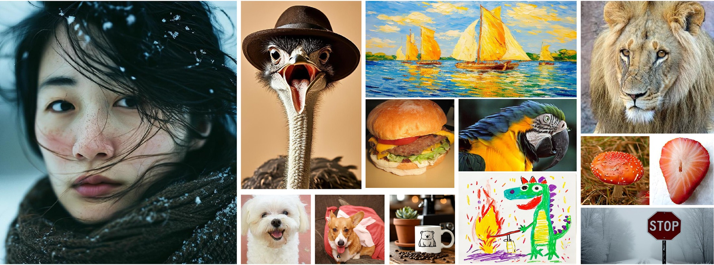
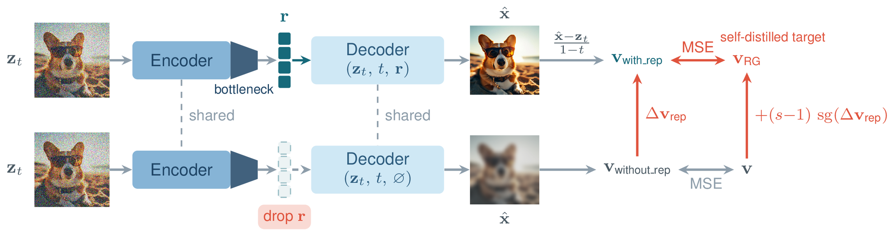
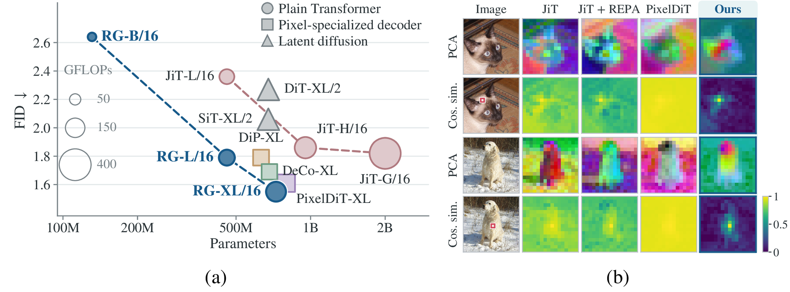

<div align="center">

<h1>Learning Representations to Guide<br>Pixel Diffusion Transformers</h1>

<p>
<a href="https://pan-zihao.github.io/">Zihao Pan</a><sup>1,2,3</sup>&ensp;
<a href="https://mengtingchen.github.io/">Mengting Chen</a><sup>2,†</sup>&ensp;
<a href="https://chengshiest.github.io/">Cheng Shi</a><sup>3</sup>&ensp;
<a href="https://hutaihang.github.io/">Taihang Hu</a><sup>2</sup>&ensp;
<a href="https://zhengrongyue.github.io/">Zhengrong Yue</a><sup>4</sup><br>
<a href="https://scholar.google.com/citations?user=WNnyy9YAAAAJ&hl=zh-CN">Zikang Wang</a><sup>4</sup>&ensp;
Yuan Wang<sup>2</sup>&ensp;
Wei Li<sup>2</sup>&ensp;
<a href="https://sibeiyang.github.io/">Sibei Yang</a><sup>1,✉</sup>
</p>

<p>
<sup>1</sup>Sun Yat-sen University&ensp;
<sup>2</sup>Alibaba Group&ensp;
<sup>3</sup>The University of Hong Kong&ensp;
<sup>4</sup>Shanghai Jiao Tong University<br>
<sub><sup>†</sup>Project leader&ensp;<sup>✉</sup>Corresponding author</sub>
</p>

<p>
<a href="https://pan-zihao.github.io/Representation-Guidance/"></a>
<a href="#"></a>
<a href="#citation"></a>
</p>

</div>

<p align="center">
  
</p>
<p align="center"><sub><b>High-quality pixel-space generation with a plain Transformer.</b> Samples at resolutions from 256×256 to 1024×1024.</sub></p>

## Overview

We introduce **Representation Guidance (RG)**, which directly forms and exploits internal representations while retaining a plain Transformer architecture. A low-dimensional bottleneck forces generation-relevant information into a compact representation, which is then explicitly used to guide decoder generation by modifying the flow-matching target according to its induced prediction offset.

<p align="center">
  
</p>

<div align="center">
<table>
  <tr><th>ImageNet 256×256</th><th>ImageNet 512×512</th><th>GenEval</th><th>DPG-Bench</th></tr>
  <tr align="center"><td><b>1.55</b> FID</td><td><b>1.74</b> FID</td><td><b>0.89</b></td><td><b>87.1</b></td></tr>
</table>
</div>

<p align="center">
  
</p>
<p align="center"><sub><b>RG enables efficient scaling and better internal representations.</b> (a) RG scales consistently from B to XL. (b) RG learns clearer spatial structure and more localized semantic correspondence.</sub></p>

## TODO

- [ ] Release ImageNet training and evaluation code
- [ ] Release text-to-image training and evaluation code
- [ ] Release ImageNet model weights
- [ ] Release text-to-image model weights

## Citation

If you find this work useful, please consider citing:

```bibtex
@article{pan2026learning,
  title   = {Learning Representations to Guide Pixel Diffusion Transformers},
  author  = {Pan, Zihao and Chen, Mengting and Shi, Cheng and Hu, Taihang and
             Yue, Zhengrong and Wang, Zikang and Wang, Yuan and Li, Wei and Yang, Sibei},
  journal = {arXiv preprint},
  year    = {2026}
}
```

## Contact

For questions, please contact Zihao Pan (panzh33@mail2.sysu.edu.cn).
